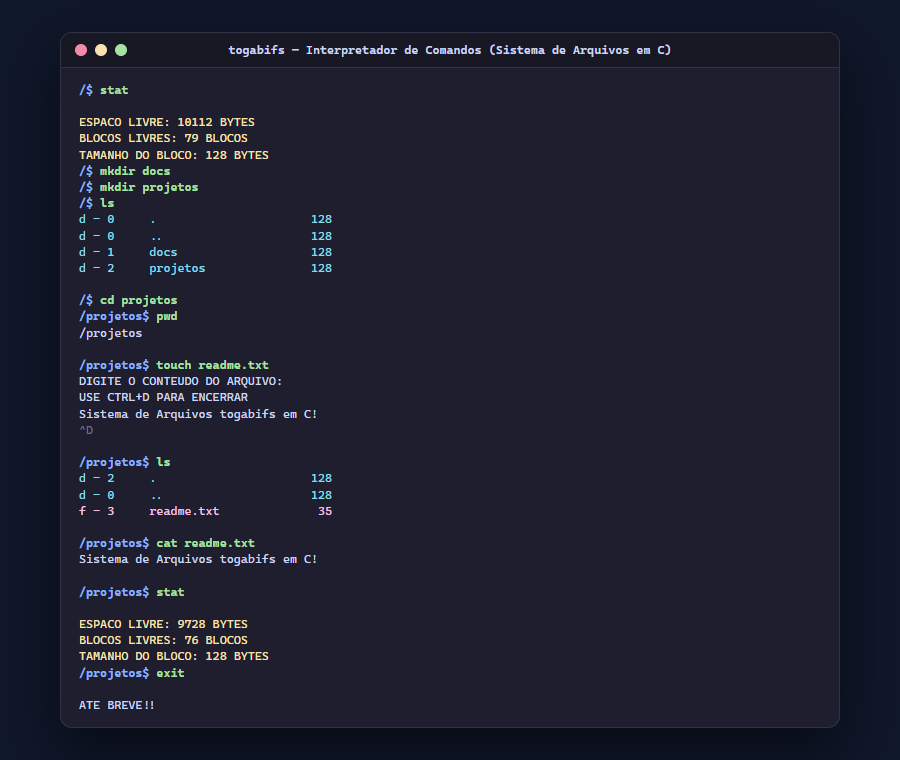

# 💾 Sistema de Arquivos `togabifs` em C


Implementação de um **sistema de arquivos simulado com persistência em disco** e um **interpretador de comandos (shell)** interativo desenvolvido em linguagem **C** para a disciplina de **Sistemas Operacionais 2** (IFSP Campus Presidente Epitácio).

📄 A fundamentação teórica e as decisões de projeto estão documentadas no arquivo [Explicação da estrutura.pdf](Explicação%20da%20estrutura.pdf).

---

## 📸 Execução no Terminal

Demonstração real dos comandos `stat`, `mkdir`, `ls`, `cd`, `pwd`, `touch`, `cat` e `exit` com atualização dinâmica dos blocos livres e tamanho dos arquivos:



---

## 🧠 Arquitetura e Estruturas de Dados

Todo o armazenamento do sistema de arquivos é persistido na pasta `fs/`, organizada nos arquivos `superblock.dat`, `inodes.dat`, `freespace.dat` e nos blocos individuais em `fs/blocks/*.dat`.

- **Superbloco (`gerir_superbloco.h` / `fs/superblock.dat`):**
  - Identificação: `filesystem=togabifs`
  - Tamanho do bloco: `128` bytes
  - Tamanho da partição: `10240` bytes (`80` blocos no total)
  - Ponteiro `next` indicando o próximo inode livre da lista encadeada.
- **Diretórios com Árvore Binária de Busca (`estrutura_dados_diretorios.h`):**
  - As entradas de cada diretório (`.`, `..`, arquivos e subdiretórios, com nomes de até 14 caracteres) são organizadas em uma **árvore binária ordenada alfabeticamente**, evitando buscas exaustivas e descartando metade dos caminhos a cada comparação.
- **Gerenciamento de Inodes (`gerenciamento_inode.h`):**
  - Utiliza uma **lista encadeada de inodes livres** (`prox_livre`), permitindo alocação e liberação em tempo constante a partir do índice salvo no superbloco. Cada inode suporta até **10 ponteiros diretos de blocos** (`blocos[10]`).
- **Gerenciamento de Espaço Livre (`manipulacao_blocos.h` / `fs/freespace.dat`):**
  - Implementado com **mapa de bits (bitmap)**, armazenando um bit por bloco (`0` para livre e `1` para ocupado), garantindo tamanho fixo em memória e verificação rápida de blocos disponíveis.

---

## 💻 Comandos Suportados no Shell

| Comando | Descrição | Exemplo |
| :--- | :--- | :--- |
| `mkdir <nome>` | Cria um novo diretório no diretório atual | `mkdir projetos` |
| `cd <caminho>` | Altera o diretório atual (suporta `/`, `..` e caminhos) | `cd projetos` |
| `pwd` | Exibe o caminho do diretório atual | `pwd` |
| `touch <arquivo>` | Cria um arquivo e lê seu conteúdo até `CTRL+D` | `touch readme.txt` |
| `cat <arquivo>` | Exibe o conteúdo armazenado em um arquivo | `cat readme.txt` |
| `ls` | Lista entradas do diretório com tipo (`d`/`f`), inode e tamanho | `ls` |
| `rm <nome>` | Remove um arquivo ou diretório do diretório atual | `rm readme.txt` |
| `stat` | Exibe espaço livre em bytes, blocos livres e tamanho do bloco | `stat` |
| `exit` | Encerra o interpretador de comandos | `exit` |

---

## 📁 Estrutura de Arquivos

```text
File-system-in-C-programming/
├── principal.c                     # Loop principal do shell e despacho de comandos
├── estruturas.h                    # Definições de tp_entrada_diretorio, tp_no e tp_inode
├── gerir_superbloco.h              # Leitura e atualização de fs/superblock.dat
├── gerenciamento_inode.h           # Alocação, liberação e persistência de inodes
├── estrutura_dados_diretorios.h    # Árvore binária de entradas de diretório
├── manipulacao_blocos.h            # Mapa de bits e leitura/escrita em fs/blocks/
├── funcoes.h                       # Implementação dos comandos do sistema de arquivos
├── Explicação da estrutura.pdf     # Documento técnico detalhando as estruturas adotadas
└── images/
    └── execucao-terminal.png       # Captura da execução no terminal
```

---

## 🚀 Como Compilar e Executar

O código é compatível com **Linux** e **Windows** (`#ifdef __linux__` / `#elif _WIN32`).

```bash
# Clonar o repositório
git clone https://github.com/rtobias-git/File-system-in-C-programming.git
cd File-system-in-C-programming

# Compilar com GCC
gcc principal.c -o togabifs

# Executar (em Linux use ./togabifs; no Windows use togabifs.exe)
./togabifs
```

---

## 👥 Autores

- **Tobias Rafael da Silva Rosa** — [@rtobias-git](https://github.com/rtobias-git)
- **Gabriel Pontel de Mori**
